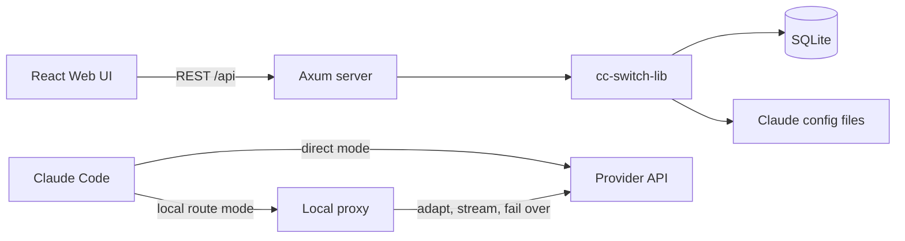

<p align="center">
  
</p>
<p align="center">
  <a href="https://github.com/huangbogeng/cc-switch-ui/releases"></a>
  <a href="https://github.com/huangbogeng/cc-switch-ui/actions/workflows/ci.yml"></a>
  <a href="LICENSE"></a>
</p>
<p align="center"><a href="README_zh.md">中文</a> · <a href="#quick-start">Quick start</a> · <a href="docs/README.md">Documentation</a> · <a href="https://github.com/huangbogeng/cc-switch-ui/releases">Releases</a></p>

A Web + Rust fork of [cc-switch](https://github.com/farion1231/cc-switch), focused on Claude Code and suitable for local or headless machines. Manage providers, Codex / Copilot OAuth, MCP, Skills, usage and protocol conversion through a consistent English interface.

> This guide describes the current repository; released binaries may lag behind. Automatic upgrades require release checksum assets. See the [upgrade guide](docs/upgrading.md) for the first upgrade from an older version. The admin API binds to `127.0.0.1` by default.

## Contents

- [How it works](#how-it-works)
- [Features](#features)
- [Supported providers](#supported-providers)
- [Quick start](#quick-start)
- [Updates and recovery](#updates-and-recovery)
- [Configuration and data](#configuration-and-data)
- [Architecture](#architecture)
- [Development](#development)
- [Project scope](#project-scope)

## How it works

CC Switch UI keeps direct provider selection and local routing as two separate controls:

| Mode | What Claude Code uses | When to use it |
|------|------------------------|----------------|
| **Direct configuration** | The selected provider's endpoint and credentials are written to `~/.claude/settings.json` | Simple provider switching without a local proxy |
| **Local route** | Claude Code connects to the local proxy, which forwards to the selected route target | Protocol conversion, request logs, circuit breaking, or failover |

Changing the route target does not overwrite the selected direct provider. Stopping the local route restores a consistent direct configuration.

## Features

| Everyday management | Routing and configuration protection |
|---------------------|--------------------------------------|
| **Providers** — 17 presets, custom endpoints, model discovery and search | **Local Route** — Anthropic / OpenAI Chat / OpenAI Responses, streaming, circuit breaking and failover |
| **OAuth** — Codex and GitHub Copilot multi-account management | **Codex subscription** — OAuth through the local route, without an API key |
| **MCP / Skills** — import, enable/disable, collections and sync | **Guarded writes** — preserve user fields, detect conflicts and recover interrupted operations |
| **Usage** — request logs, session imports, trends and source breakdown | **Backup Center** — database, configuration-file and Skills recovery |

## Supported providers

Local-route capabilities vary by protocol. Gemini native conversion is not implemented; its preset remains available for configuration and model discovery. See [protocol compatibility](docs/protocol-compatibility.md).

The UI includes **17 presets across 14 provider brands**, plus custom compatible endpoints. Logos are bundled locally and shared by the picker and provider list. Presets are starting configurations; account access and available models depend on the service.

| Provider | Authentication | Presets |
|----------|------------------------|----------------|
| Claude Official | Existing Claude Code login | Claude Official |
| Codex | Managed ChatGPT OAuth; local route | Codex |
| DeepSeek | API key | DeepSeek |
| MiniMax | API key | MiniMax |
| SiliconFlow | API key | SiliconFlow |
| OpenRouter | API key | OpenRouter |
| Google | API key | Gemini Native |
| Kimi | API key | Kimi, Kimi For Coding, Kimi For Coding Global |
| Zhipu | API key | Zhipu GLM, Zhipu GLM en |
| Volcengine | API key | Volcengine Coding Plan |
| Qwen | API key | Qwen Coding Plan |
| AiHubMix | API key | AiHubMix |
| PPIO | API key | PPIO |


Custom providers can use `anthropic`, `openai_chat`, `openai_responses`, or Gemini-compatible protocols. For an unknown endpoint, use **Detect endpoint type** and **Fetch models** in the provider editor.

Codex OAuth uses the connected account for **Fetch models** and **Check OAuth connection**, with a fixed Responses protocol. Fetched choices are shared by all four editable model mappings. See the [provider editor guide](docs/provider-editor.md) for selection, diagnostics and explicit save behavior; consult release notes for availability in published binaries.

## Quick start

### 1. Install on Linux or macOS

```bash
curl -fsSL https://raw.githubusercontent.com/huangbogeng/cc-switch-ui/main/install.sh | bash
```

The installer places the application under `~/.local/share/cc-switch-ui` and keeps user data in `~/.cc-switch`.

For other platforms, download a build from [GitHub Releases](https://github.com/huangbogeng/cc-switch-ui/releases) or build from source.

### 2. Start the service

```bash
# Defaults: admin UI on 127.0.0.1:5007, local proxy on 15721
cc-switch-ui start
```

Open [http://localhost:5007/ui](http://localhost:5007/ui) and sign in with the admin token printed in the startup log.

Useful CLI commands:

```bash
cc-switch-ui status   # Check service health
cc-switch-ui doctor   # Diagnose installation, PATH, and permission issues
cc-switch-ui version  # Print the installed version
cc-switch-ui stop     # Stop the managed service
```

To listen beyond the local machine, opt in explicitly:

```bash
cc-switch-ui start --host 0.0.0.0 --port 5007 --proxy-port 15721
```

### 3. Add and switch a provider

1. Open **Providers**.
2. Choose a preset or create a custom provider.
3. Enter the required API key or complete OAuth authorization.
4. Save the provider and select **Select**.

With the route stopped, Claude Code uses the selected direct provider. During routing, the selection applies after stopping. Codex OAuth requires the local route; follow the [subscription routing guide](docs/user-guide.md).

### 4. Optional: enable the local route

1. In **Providers**, choose a **Route Target** in the **Local Route** panel.
2. Start the local route.

Claude Code now sends requests to the local proxy, which adapts and forwards them to the route target. Stop the route to return to direct configuration.

### Codex subscription: no API key

**OAuth → ChatGPT Codex → Connect** → add the **Codex** preset → choose **ChatGPT Account** → **Route Target → Start Route**.

The local service forwards requests with managed OAuth credentials and protocol conversion. Connecting an account does not start routing. Follow the [user guide](docs/user-guide.md) for the complete workflow.

## Updates and recovery

See the [v0.3.4 release notes](docs/releases/v0.3.4.md) for explicit custom-model context windows and recovery regression coverage. The [v0.3.3 notes](docs/releases/v0.3.3.md) cover Codex OAuth model discovery, diagnostics and model mapping menus. Check [published releases](https://github.com/huangbogeng/cc-switch-ui/releases) for availability.

```bash
cc-switch-ui update          # Latest stable release; Linux/macOS release installations
cc-switch-ui update --force  # Reinstall the current stable release
```

An older binary without `update` needs one upgrade through the installer first. Downloads, checksums and binary versions are verified before replacement. Existing databases receive a private pre-migration snapshot; installer upgrades also retain the previous program and complete profile for rollback. A failed health check restores the previous installation and profile when rollback succeeds.

- [Upgrade guide](docs/upgrading.md): first upgrade, backup locations, rollback and release prerequisites.
- [User guide](docs/user-guide.md): direct providers, Codex subscription routing, MCP, Skills and usage.
- [Recovery reference](docs/configuration-recovery.md): guarded file writes, conflicts, pending operations and staged database restoration.
- [Troubleshooting](docs/troubleshooting.md): login, route state, deletion recovery and partial sync results.

**Settings → Claude Code User Settings** owns API timeout and nonessential-traffic overrides. These settings are independent of provider selection. **Settings → Backup Center** groups database, configuration-file and Skills backups; a database snapshot alone does not include the entire profile.

## Configuration and data

### Environment variables

| Variable | Default | Description |
|----------|---------|-------------|
| `CC_SWITCH_ADMIN_TOKEN` | Generated at startup | Admin token for the Web UI and API |
| `CC_SWITCH_PROXY_PORT` | `15721` | Local proxy listening port |
| `CC_SWITCH_UI_DIR` | Auto-detected | Directory containing built frontend assets |

The admin host and port can be changed with `cc-switch-ui start --host ... --port ...`. CLI settings are persisted in `~/.cc-switch/cli.json`.

### Managed paths

| Path | Purpose |
|------|---------|
| `~/.cc-switch/cc-switch.db` | Providers, routes, MCP, Skills metadata, and usage data |
| `~/.cc-switch/cli.json` | CLI host and port settings |
| `~/.cc-switch/skills/` | Skills source of truth managed by CC Switch UI |
| `~/.claude/settings.json` | Active Claude Code provider configuration |
| `~/.claude.json` | Claude Code MCP server configuration |
| `~/.claude/skills/` | Enabled Claude Code Skills |

Back up `~/.cc-switch` before migrating or removing an installation. API keys and OAuth credentials are sensitive data.

## Architecture



The Rust workspace contains three crates:

- `cc-switch-cli`: installation-facing command-line entry point and service lifecycle.
- `cc-switch-server`: REST API, OAuth callbacks, static UI hosting, and local proxy.
- `cc-switch-lib`: persistence, live configuration, MCP/Skills synchronization, and OAuth core logic.

The frontend lives in `cc-switch-ui/` and is built with React, TypeScript, and Vite.

## Development

Requires Node.js **24.15+**, npm and Rust **1.95**, pinned in `rust-toolchain.toml`.

```bash
# Repository root, terminal 1
cargo run -p cc-switch-server

# Terminal 2
cd cc-switch-ui
npm ci
npm run dev
```

See the [development guide](docs/development.md) for production builds, frontend/Rust checks, isolated workflow tests and old-release upgrade regressions. Follow the [frontend design conventions](docs/frontend-design.md) and [contributing guide](CONTRIBUTING.md).

## Project scope

| Capability | cc-switch | CC Switch UI |
|------------|-----------|--------------|
| Deployment | Tauri desktop application | Browser UI and headless Web service |
| System tray | Yes | No |
| Tool focus | Multiple AI coding tools | Claude Code CLI |
| MCP and Skills | Yes | Yes, Claude Code focused |
| Cloud sync | Yes | No |
| OAuth accounts | Multiple providers | Codex and GitHub Copilot multi-account support |

## Acknowledgements

CC Switch UI is built from the open-source [cc-switch](https://github.com/farion1231/cc-switch) project. Thanks to its maintainers and contributors.

## License

Licensed under the [MIT License](LICENSE).
