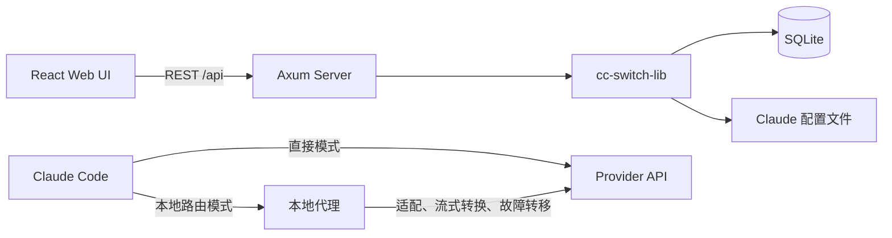

<p align="center">
  
</p>
<p align="center">
  <a href="https://github.com/huangbogeng/cc-switch-ui/releases"></a>
  <a href="https://github.com/huangbogeng/cc-switch-ui/actions/workflows/ci.yml"></a>
  <a href="LICENSE"></a>
</p>
<p align="center"><a href="README.md">English</a> · <a href="#快速开始">快速开始</a> · <a href="docs/README.md">使用指南</a> · <a href="https://github.com/huangbogeng/cc-switch-ui/releases">下载</a></p>

基于 [cc-switch](https://github.com/farion1231/cc-switch) 的 Web + Rust 项目，面向 Claude Code，适合本地使用和无头服务器。统一管理 Provider、Codex / Copilot OAuth、MCP、Skills、用量及协议转换。界面文案统一为英文；本页保留中文操作说明。

> 本页描述当前仓库代码；已发布版本可能暂未包含最新功能。自动升级需要带校验文件的新版本；旧版首次升级见[升级指南](docs/upgrading.md)。管理接口默认监听 `127.0.0.1`。

## 目录

- [工作方式](#工作方式)
- [功能](#功能)
- [支持的 Provider](#支持的-provider)
- [快速开始](#快速开始)
- [升级与恢复](#升级与恢复)
- [配置与数据](#配置与数据)
- [架构](#架构)
- [开发](#开发)
- [项目定位](#项目定位)

## 工作方式

CC Switch UI 将“直接 Provider”和“本地路由”作为两个彼此独立的控制项：

| 模式 | Claude Code 实际使用的配置 | 适用场景 |
|------|----------------------------|----------|
| **直接配置** | 将所选 Provider 的端点与凭证写入 `~/.claude/settings.json` | 不经过本地代理，快速切换 Provider |
| **本地路由** | Claude Code 连接本地代理，再由代理转发到路由目标 | 协议转换、请求日志、熔断或故障转移 |

修改路由目标不会覆盖当前选择的直接 Provider；停止本地路由后，系统会恢复一致的直接配置。

## 功能

| 日常管理 | 路由与配置保护 |
|----------|----------------|
| **Providers** — 17 个预设、自定义端点、模型发现与搜索 | **Local Route** — Anthropic / OpenAI Chat / OpenAI Responses、流式转换、熔断与故障转移 |
| **OAuth** — Codex、GitHub Copilot 多账号管理 | **Codex 订阅** — OAuth + 本地路由，不填写 API Key |
| **MCP / Skills** — 导入、启停、集合管理与同步 | **安全写入** — 保留用户字段、检测冲突、恢复中断操作 |
| **Usage** — 请求日志、会话导入、趋势与来源统计 | **Backup Center** — 数据库、配置文件和 Skills 的分层恢复 |

## 支持的 Provider

UI 内置 **17 个预设，覆盖 14 个服务商品牌**，也支持自定义兼容端点。选择器和列表共用本地 Logo；预设是初始配置，账号权限和可用模型以服务商为准。

| Provider | 认证 | 预设 |
|----------|------------------------|----------------|
| Claude Official | 已有 Claude Code 登录 | Claude Official |
| Codex | ChatGPT OAuth + 本地路由 | Codex |
| DeepSeek | API key | DeepSeek |
| MiniMax | API key | MiniMax |
| SiliconFlow | API key | SiliconFlow |
| OpenRouter | API key | OpenRouter |
| Google | API key | Gemini Native |
| Kimi | API key | Kimi, Kimi For Coding, Kimi For Coding Global |
| Zhipu | API key | Zhipu GLM, Zhipu GLM en |
| Volcengine | API key | Volcengine Coding Plan |
| Qwen | API key | Qwen Coding Plan |
| AiHubMix | API key | AiHubMix |
| PPIO | API key | PPIO |


自定义 Provider 可选择 `anthropic`、`openai_chat`、`openai_responses` 或 Gemini 兼容协议。面对未知端点时，可在 Provider 编辑器中使用**检测端点类型**与**获取模型**。

Codex OAuth 固定使用 Responses 协议，通过已连接账号执行 **Fetch models** 和 **Check OAuth connection**。获取的模型列表供四个可手动编辑的映射菜单共用；选择、诊断与显式保存的行为见[服务商编辑说明](docs/provider-editor.md)。文档覆盖当前源码，已发布版本的功能请核对发布说明。

本地路由目前支持前三种协议。Gemini 原生转换尚未实现，预设保留用于配置与模型发现；选择或启动此类路由会明确报错。工具延迟加载和加密 reasoning 多轮回传等边界见[协议兼容说明](docs/protocol-compatibility.md)。

## 快速开始

### 1. 在 Linux 或 macOS 上安装

```bash
curl -fsSL https://raw.githubusercontent.com/huangbogeng/cc-switch-ui/main/install.sh | bash
```

安装脚本默认将程序放在 `~/.local/share/cc-switch-ui`，用户数据保存在 `~/.cc-switch`。

其他平台可从 [GitHub Releases](https://github.com/huangbogeng/cc-switch-ui/releases) 下载构建产物，或按照后文从源码构建。

### 2. 启动服务

```bash
# 默认：管理界面监听 127.0.0.1:5007，本地代理监听 15721
cc-switch-ui start
```

打开 [http://localhost:5007/ui](http://localhost:5007/ui)，使用启动日志中打印的 admin token 登录。

常用 CLI 命令：

```bash
cc-switch-ui status   # 检查服务状态
cc-switch-ui doctor   # 诊断安装、PATH 与权限问题
cc-switch-ui version  # 查看安装版本
cc-switch-ui stop     # 停止托管服务
```

如果确实需要从其他设备访问，请显式开放监听：

```bash
cc-switch-ui start --host 0.0.0.0 --port 5007 --proxy-port 15721
```

### 3. 添加并切换 Provider

1. 打开 **Providers** 页面。
2. 选择预设，或新建自定义 Provider。
3. 填写 API Key，或完成 OAuth 授权。
4. 保存后点击 **Select**。

路由停止时，Claude Code 使用所选的直接 Provider；路由运行时，选择会在停止路由后生效。Codex OAuth 必须通过本地路由使用，详见[使用指南](docs/user-guide.md)。

### 4. 可选：启用本地路由

1. 在 **Providers** 页面的**Local Route** 区域选择 **Route Target**。
2. 点击 **Start Route**。

此后 Claude Code 的请求会先进入本地代理，再经过适配后转发到路由目标。停止路由即可回到直接配置。

### Codex 订阅：无需 API Key

**OAuth → ChatGPT Codex → Connect** → 添加 **Codex** 预设 → 选择 **ChatGPT Account** → **Route Target → Start Route**。

本地服务使用 OAuth 账号转发请求并完成协议转换。授权完成不会自动启动路由；详细步骤见[使用指南](docs/user-guide.md)。

## 升级与恢复

Codex OAuth 模型获取、连接诊断、映射菜单和升级检查见 [v0.3.3 发布说明](docs/releases/v0.3.3.md)；之前的协议与配置改动见 [v0.3.2 说明](docs/releases/v0.3.2.md)。实际发布状态请核对 [Releases](https://github.com/huangbogeng/cc-switch-ui/releases)。

```bash
cc-switch-ui update          # 更新到稳定发布版本；Linux/macOS 发布包安装
cc-switch-ui update --force  # 重新安装当前稳定版本
```

不支持 `update` 的旧版，需要先通过安装脚本升级一次。更新在替换前验证下载、校验和及二进制版本。数据库迁移前自动保留私有快照；安装升级另保留旧程序和完整用户目录。新服务健康检查失败时会尝试恢复旧程序与数据，并重启原先运行的服务。

- [升级指南](docs/upgrading.md)：旧版首次升级、备份位置、失败回滚与发布条件。
- [使用指南](docs/user-guide.md)：直接配置、Codex 订阅路由、MCP、Skills 和用量。
- [恢复参考](docs/configuration-recovery.md)：文件保护、冲突、待恢复操作和数据库恢复。
- [常见问题](docs/troubleshooting.md)：登录、路由状态、删除恢复与部分同步失败。

**Settings → Claude Code User Settings** 直接修改 API 超时和非必要流量开关，独立于服务商选择。**Settings → Backup Center** 汇总数据库、配置文件和 Skills 备份；数据库快照不等于整个用户目录备份。

## 配置与数据

### 环境变量

| 变量 | 默认值 | 说明 |
|------|--------|------|
| `CC_SWITCH_ADMIN_TOKEN` | 启动时生成 | Web UI 与 API 的管理 token |
| `CC_SWITCH_PROXY_PORT` | `15721` | 本地代理监听端口 |
| `CC_SWITCH_UI_DIR` | 自动检测 | 前端构建产物所在目录 |

管理接口的 host 与 port 可通过 `cc-switch-ui start --host ... --port ...` 修改。CLI 配置会持久化到 `~/.cc-switch/cli.json`。

### 管理的路径

| 路径 | 用途 |
|------|------|
| `~/.cc-switch/cc-switch.db` | Provider、路由、MCP、Skills 元数据与用量数据 |
| `~/.cc-switch/cli.json` | CLI host 与 port 配置 |
| `~/.cc-switch/skills/` | CC Switch UI 管理的 Skills 单一事实源 |
| `~/.claude/settings.json` | Claude Code 当前 Provider 配置 |
| `~/.claude.json` | Claude Code MCP Server 配置 |
| `~/.claude/skills/` | 已启用的 Claude Code Skills |

迁移或移除安装前，请备份 `~/.cc-switch`。API Key 与 OAuth 凭证属于敏感数据。

## 架构



Rust workspace 包含三个 crate：

- `cc-switch-cli`：面向安装用户的命令行入口与服务生命周期管理。
- `cc-switch-server`：REST API、OAuth 回调、前端静态资源托管和本地代理。
- `cc-switch-lib`：持久化、实时配置、MCP/Skills 同步与 OAuth 核心逻辑。

前端位于 `cc-switch-ui/`，使用 React、TypeScript 与 Vite。

## 开发

环境：Node.js **24.15+**、npm、Rust **1.95**（工具链固定在 `rust-toolchain.toml`）。

```bash
# 项目根目录，终端 1
cargo run -p cc-switch-server

# 终端 2
cd cc-switch-ui
npm ci
npm run dev
```

完整构建、Rust / 前端检查、隔离流程测试和旧版升级回归见[开发指南](docs/development.md)。前端布局、弹窗、通知及品牌约定见[设计指南](docs/frontend-design.md)。贡献前阅读 [CONTRIBUTING.md](CONTRIBUTING.md)。

## 项目定位

| 能力 | cc-switch | CC Switch UI |
|------|-----------|--------------|
| 部署方式 | Tauri 桌面应用 | 浏览器 UI 与无头 Web 服务 |
| 系统托盘 | 支持 | 不支持 |
| 工具定位 | 多种 AI 编程工具 | Claude Code CLI |
| MCP 与 Skills | 支持 | 支持，聚焦 Claude Code |
| 云同步 | 支持 | 不支持 |
| OAuth 账号 | 多 Provider | Codex 与 GitHub Copilot 多账号 |

## 致谢

CC Switch UI 基于开源项目 [cc-switch](https://github.com/farion1231/cc-switch) 开发，感谢原项目维护者与贡献者。

## License

本项目基于 [MIT License](LICENSE) 开源。
